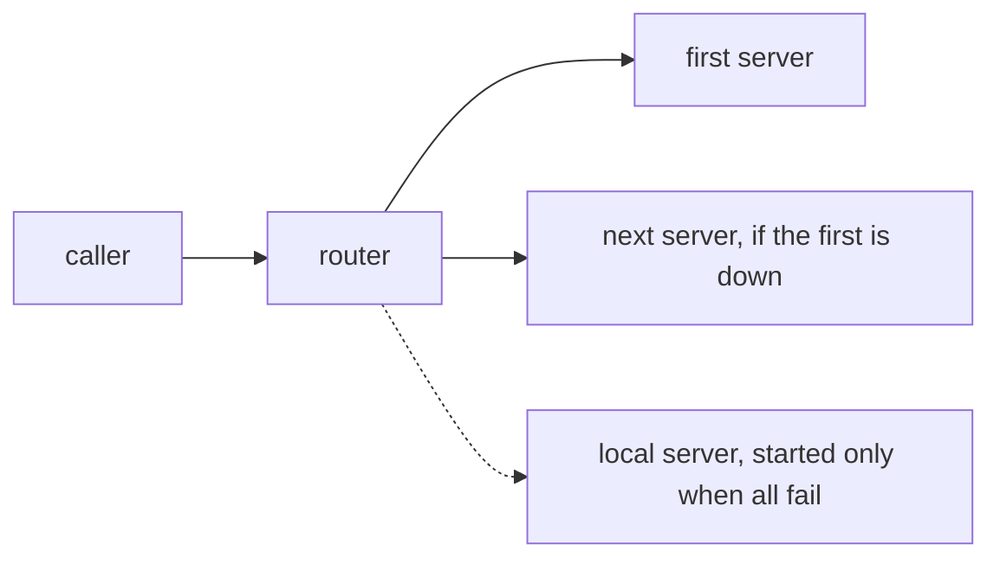

# whisper-service

A speech-to-text server that keeps a [faster-whisper](https://github.com/SYSTRAN/faster-whisper) model loaded, and a small router that forwards requests to other copies of it. Both are plain Python on the standard-library HTTP server.

Loading Python, CUDA and the model takes about five seconds, which is a poor deal for a short voice note. This server loads the model once, and every program on the machine that needs transcription calls it.

```bash
# the file is on the server's own disk, so nothing is uploaded
curl -s -X POST http://127.0.0.1:8771/transcribe \
  -H "Content-Type: application/json" \
  -d '{"path": "/srv/audio/note.ogg", "segments": true}'
```

```json
{
  "text": "Quarterly revenue rose twelve percent year over year.",
  "language": "en",
  "duration": 3.42,
  "infer_ms": 241,
  "segments": [
    {"start": 0.0, "end": 3.42, "text": "Quarterly revenue rose twelve percent year over year."}
  ]
}
```

The same route takes an upload or raw bytes, and there is an OpenAI-style route for clients that expect one.

```bash
# multipart upload, with word timings and a vocabulary hint
curl -s -X POST http://127.0.0.1:8771/transcribe \
  -F "file=@clip.ogg" -F "words=true" -F "initial_prompt=AAPL, MSFT, GOOGL"

# raw audio in the body, options in the query string
curl -s -X POST "http://127.0.0.1:8771/transcribe?language=en&vad=0" \
  --data-binary @clip.ogg

# OpenAI-compatible route
curl -s -X POST http://127.0.0.1:8771/v1/audio/transcriptions \
  -F "file=@clip.ogg" -F "model=whisper-1" -F "response_format=json"
# {"text": "Quarterly revenue rose twelve percent year over year."}
```

## The routes

`POST /transcribe` is the native route. It takes a JSON body with a `path`, a multipart upload, or raw audio. The `path` form exists so a large media file never has to travel through an HTTP body. Everything is converted to 16 kHz mono WAV with ffmpeg before decoding.

`POST /v1/audio/transcriptions` is the OpenAI-style route, used by clients such as Open WebUI. It ignores the `model` field and uses the model the server loaded. `response_format` can be `json`, `text` or `verbose_json`.

`GET /v1/models` lists the loaded model, which Open WebUI checks before it sends audio. `GET /health` says which model and device are in use and whether the weights are in memory.

The native route takes these options in the JSON body, as form fields, or in the query string:

- `language`: a language code. Leave it out, or send `auto`, to detect it.
- `segments`: add the start, end and text of each sentence.
- `words`: add the start and end of each word. This implies `segments`.
- `vad`: the speech filter. It is on by default and off in multilingual mode. Turn it off for film dialogue under a score, which the filter tends to drop.
- `initial_prompt`: words to prime the decoder with, so tickers and names come out right. JSON and multipart only.
- `beam_size`: 5 by default, which is the original Whisper default. Pass 1 for lower latency. JSON and multipart only.
- `multilingual`: for clips that change language. Each chunk is decoded without the text before it. JSON only.

## Sharing a GPU

This server was built to live on a GPU that other models also use. An idle 1.6 GB model can push such a card into shared system memory, so there are two guards.

**Idle unload.** Set `WHISPER_IDLE_UNLOAD_S` and a background thread releases the weights once the model has been idle that long. A count of running transcriptions stops it unloading in the middle of one. The next request loads the model again.

**Free-memory check.** Set `WHISPER_MIN_FREE_MB` and the server asks `nvidia-smi` how much memory is free before it loads. If there is less, it answers `503 GPU busy` and loads nothing. Without the check, the driver would quietly back the model with system RAM. A router in front treats the 503 as a reason to try the next server.

By default the server loads the model first and listens afterwards, so a health check never lands on a server that is still loading. `WHISPER_LAZY_LOAD=1` loads on the first request instead.

## The router

`router.py` answers on the same routes but loads no model. Use it on a machine whose GPU should stay free, or to fall back from one machine to another.



**Skipping a dead server.** A transcription can run for minutes, so the router waits up to fifteen minutes for an answer. That is too long to spend on a machine that is asleep. So before it sends any audio, it asks the server's `/health` with a five-second limit. A server that fails the check, times out or answers with a 5xx is skipped. A 4xx is the caller's mistake and goes straight back.

**Local paths.** A server on the same host gets a `path` request unchanged and reads the file. A server on another host cannot, so the router uploads the file for it with the same options. A file over 25 MB is first cut down to 32 kbps Opus audio, so a film is not sent as video.

**Last resort.** Set `WHISPER_LOCAL_URL` and `WHISPER_LOCAL_START`. If every upstream fails, the router runs the start command, waits for the local server's health check, and sends the request there. The router's own `/health` reports this server as `"on_demand": true` and does not start it, because a health check should not load a model.

## Listeners and scratch space

Both programs listen on `127.0.0.1:8771`. They also listen on `172.17.0.1:8899`, the Docker bridge gateway, so containers can reach the service. Binding `0.0.0.0` would open it to the local network as well. If the bridge does not exist yet, as on a cold boot, the error is logged and the service carries on with loopback only. Set `WHISPER_OPENAI_HOST` to an empty string to turn the second listener off.

Uploads and temporary WAV files go to `WHISPER_SCRATCH`, with no fallback to `/tmp`. Transcribing a film library writes a lot of intermediate audio, and the root disk is the wrong place for it. Set it to a directory on a disk with room, because the built-in default is a path from the author's machine.

## Install and run

Python 3.10 or newer, and `ffmpeg` on the `PATH`.

```bash
python3 -m venv venv
source venv/bin/activate
pip install -r requirements.txt
```

Without a system CUDA toolkit, point the linker at the NVIDIA libraries that pip put in the virtualenv:

```bash
SITE=$(python3 -c "import site; print(site.getsitepackages()[0])")
export LD_LIBRARY_PATH="$SITE/nvidia/cublas/lib:$SITE/nvidia/cudnn/lib:$SITE/nvidia/cuda_nvrtc/lib"
```

Start the server, or the router with a list of servers to forward to:

```bash
WHISPER_SCRATCH=/srv/whisper-scratch python3 server.py
WHISPER_UPSTREAMS="http://gpu-host:8771" python3 router.py
```

## Configuration

| Variable | Default | Meaning |
|---|---|---|
| `WHISPER_MODEL` | `large-v3-turbo` | A faster-whisper model name, or a path to one |
| `WHISPER_DEVICE` | `cuda` | `cuda` or `cpu` |
| `WHISPER_COMPUTE` | `float16` | Also `int8_float16` and `int8`. `int8` is faster but loses quality. |
| `WHISPER_SCRATCH` | none | Where uploads and temporary files go. Set it. |
| `WHISPER_IDLE_UNLOAD_S` | `0` | Idle seconds before unloading. `0` never unloads. |
| `WHISPER_MIN_FREE_MB` | `0` | Free GPU memory needed to load. `0` skips the check. |
| `WHISPER_UPSTREAMS` | none | Router only. Server URLs in priority order. Required. |

The ports, the router's timeouts and the last-resort server settings are listed at the top of `server.py` and `router.py`.

## Tests

The tests use a fake model and never touch the GPU:

```bash
WHISPER_SCRATCH=$(mktemp -d) python3 -m pytest tests
```

## License

MIT. See [LICENSE](LICENSE).
